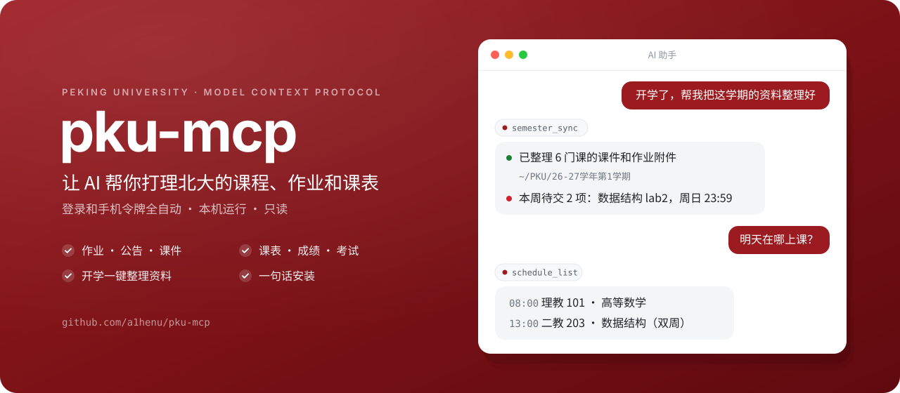

<p align="center">
  
</p>

<p align="center">
  <a href="https://github.com/a1henu/pku-mcp/actions/workflows/ci.yml"></a>
  
  
</p>

**pku-mcp 让你的 AI 助手能直接上北大教学网和校内门户**：查作业和截止时间、看公告、下课件、看课表和成绩。开学时说一句话，它就能把整个学期的课程资料下载到你电脑里，按课程分好文件夹。

登录全自动：密码和手机令牌只在你自己的电脑上，过期了它会自己重新登录、自己生成动态口令，不用你每次手动输入。

## 一句话安装

把这句话发给你的 AI 助手（Claude Code、Codex、Cursor……能在你电脑上执行命令的都行）：

```text
请阅读 https://raw.githubusercontent.com/a1henu/pku-mcp/main/docs/install-for-agents.md ，按里面的步骤帮我安装 pku-mcp。
```

接下来它会一步步带你做：装好后浏览器会打开一个本机网页，你在里面填学号和密码；如果开了手机令牌，再按页面提示粘贴一下令牌二维码；最后点「测试登录」就完成了。**全程不需要把密码告诉 AI**，电脑上也不用事先装 Python 或 Git。

## 装好以后，直接这样说

| 你说 | 它会做 |
| --- | --- |
| 「开学了，帮我把这学期的课程资料整理好」 | 下载每门课的课件、作业附件、公告附件，按课程归档，生成学期总览 |
| 「我这周还有哪些作业没交？」 | 列出未交作业、截止时间、作业要求 |
| 「明天几点在哪上课？」 | 查个人课表：节次、钟点、教室、单双周 |
| 「帮我做计算机网络的 lab2」 | 找到要求、下好附件，在作业文件夹里和你一起写（不会替你提交） |
| 「最近有什么新公告？」 | 汇总各课最新公告 |
| 「我上学期 GPA 多少？」 | 查成绩和绩点 |

整理出来的文件夹长这样，之后随时可以再说一次「同步一下资料」，只会补新文件，不会动你自己放进去的东西：

```
~/PKU/26-27学年第1学期/
├── README.md            学期总览：上课时间地点、考试、未交作业
├── 数据结构与算法/
│   ├── 课程信息.md       这门课的作业截止、公告、资料索引
│   └── 资料/  作业/  公告/
└── …
```

更多用法见 [功能与用法](docs/usage.md)。

## 放心用

- **只在你的电脑上运行**，直接连北大的网站，中间没有任何第三方服务器。
- **只读**：只查询和下载，不会替你提交作业、选课，也不会改动教学网上的任何东西。
- 密码和令牌密钥存在 `~/.pku-mcp`（只有你的系统账户能读），AI 看不到。不用了运行 `pku-mcp forget` 一键删除。
- 登录失败后会先暂停一会儿，避免把账号试到被北大锁住。

细节见 [安全与隐私](docs/security.md)。

## 常见问题

**没开手机令牌能用吗？** 能，跳过令牌那一步就行。开了令牌但不想交给电脑也可以：目前作业、公告、资料登录时不需要令牌，只有课表和成绩需要。

**怎么更新？** 跟 AI 说「帮我更新 pku-mcp」，或者自己运行：

```sh
uv tool install --reinstall --refresh --python 3.12 https://github.com/a1henu/pku-mcp/archive/refs/heads/main.zip
```

Windows 上请先退出 AI 应用再更新。

**改了密码 / 换了令牌？** 跟 AI 说「打开 pku-mcp 配置页」，或在终端运行 `pku-mcp setup`。

**怎么卸载？** `pku-mcp forget` 删除保存的账号，再 `uv tool uninstall pku-mcp`。

## 文档

- [给 Agent 的安装指南](docs/install-for-agents.md)
- [功能与用法](docs/usage.md)：全部工具、预设流程、命令行
- [安全与隐私](docs/security.md)
- [参与开发](docs/development.md)
